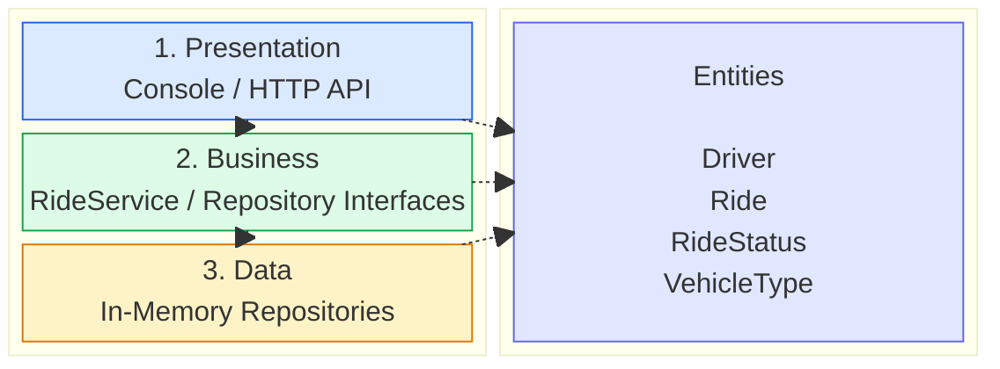

# Urban Mobility: Layered Architecture

The same small ride application implemented in **C#/.NET 10** and **TypeScript/Node.js 24**. Each version has a Console app and an HTTP API.

## Architecture



These are logical boundaries, not separate servers. Console and API use the same Business rules, but run as separate processes with separate in-memory data.

## Run C#/.NET

From the repository root, start either host:

```sh
dotnet run --project dotnet/src/Mobility.Console
```

```sh
dotnet run --project dotnet/src/Mobility.Api
```

The API is at `http://localhost:5080`; its interactive reference is [Scalar](http://localhost:5080/scalar/).

## Run TypeScript

Install dependencies once from the repository root:

```sh
cd typescript
npm ci
```

Then start either host from `typescript/`:

```sh
npm run dev:console
```

```sh
npm run dev:api
```

The API is at `http://localhost:5081`; its interactive reference is [Scalar](http://localhost:5081/scalar/).

## Build and test

From the repository root:

```sh
dotnet build dotnet/Mobility.slnx
dotnet test dotnet/Mobility.slnx
```

From `typescript/`:

```sh
npm run typecheck
npm run build
npm run test:unit
```

## Notes

- Both implementations seed six available demo drivers at startup; their IDs are printed to the console.
- Data is in memory and resets when its process stops. Console and API do not share data.
- This is a learning example, not production software: it has no authentication or persistent storage.
- See [`requests/`](requests/) for API request examples and [`docs/`](docs/) for classroom material.
