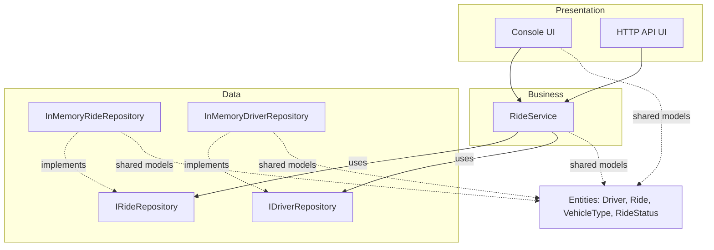
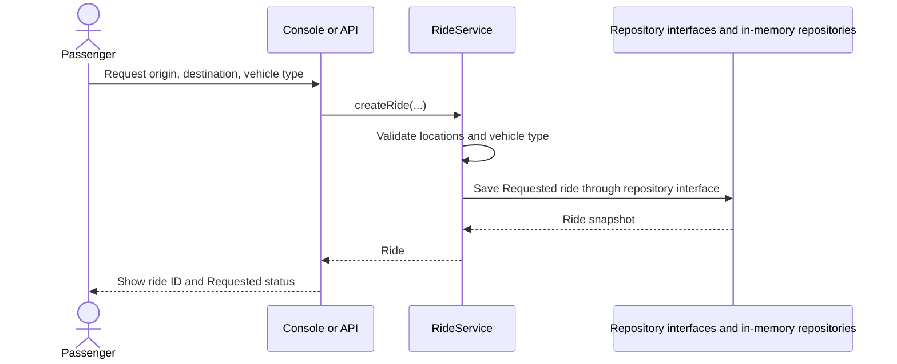
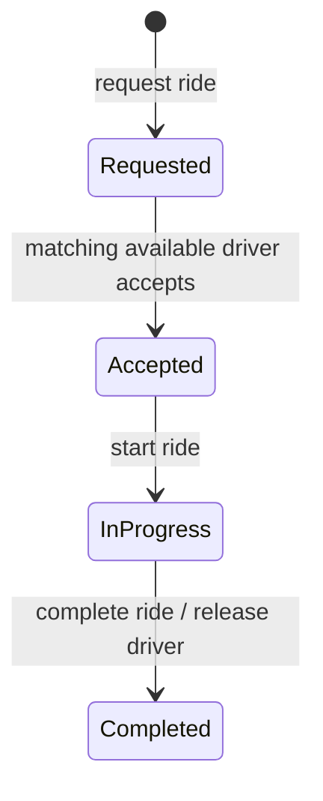

# Architecture

**Interactive diagrams:** 
 - [Layered architecture](architecture-urban-mobility/urban-mobility-architecture.html)
 - [Ride lifecycle sequence](sequence-ride-lifecycle/ride-lifecycle-sequence.html)

## Logical layers and dependency direction

Presentation calls `RideService` and has no direct relationship with Data. Business uses the repository interfaces in Data; Data contains those interfaces and their in-memory implementations. The executable hosts wire the implementations at startup. There is no direct Data-to-Presentation dependency.

**Entities** is a shared project used across the three layers. It contains the business models and enums: `Driver`, `Ride`, `VehicleType` and `RideStatus`. It is not a fourth runtime layer.

In C#, `Mobility.Entities` holds the models, `Mobility.Business` contains `RideService`, and `Mobility.Data` contains repository interfaces and their in-memory implementations. In TypeScript, the entities are in `src/entities` and the service is in `src/business`; repository interfaces currently live in `src/business/abstracts`, while in-memory implementations are in `src/data`. `src/composition` wires them at startup. Route handlers and menu rendering do not implement ride state rules.

The diagram describes **logical dependencies**, not deployment tiers. Presentation, Business and Data run in one process. Console and API are alternative presentation hosts; when both are running, they are separate processes with separate in-memory data.

## Ride request sequence

## Lifecycle

Invalid transitions are rejected by `RideService`, independent of whether the call came from Console or HTTP. Repositories return defensive copies; current domain objects contain only immutable values. The repository interfaces make it possible to add another Data implementation later.
